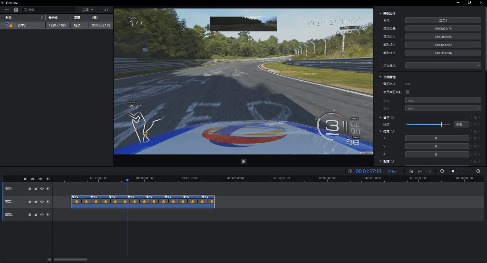

# Timeline

中文 | [English](#english)

Qt5 / C++17 时间线编辑软件。单体可执行文件 `Timeline.exe`（Libs 源码编入同一目标）。



设计文档：[doc/](doc/README.md)

## 下载

- Windows 安装包：[Timeline_Setup_V1.0.3.exe](https://github.com/wc-xiong/Timeline/releases/download/v1.0.3/Timeline_Setup_V1.0.3.exe)（[Releases](https://github.com/wc-xiong/Timeline/releases)）
- 从源码构建见下文「构建」；打包说明见 [Installer/README.md](Installer/README.md)

## 功能

- 四窗格 UI：素材库 | 预览 | 属性 | 时间线
- 素材导入与属性编辑（含音量等）
- 预览：FFmpeg 解码、D3D11 Present、SDL3 音频；硬解失败回落软解
- ClipFx：关键帧属性写回 MediaNode（Volume / Effect / Keying / Feather 等）
- TransFx：重叠自动创建、时间线半段编辑、转场属性（含顶点转场类型）
- 时间线 Play / Pause 与预览联动

## 架构

分层与主链路见 [doc/](doc/README.md)。运行时大致分为：

| 层 | 职责 |
|----|------|
| 播控 | 时钟、Seek、播放状态 |
| 预览管线 | 多路媒体同步到预览窗 |
| 渲染与特效 | Present、ClipFx、TransFx |

## 环境要求

- Windows x64，Visual Studio 2017（工具集 v141）
- Qt 5.12+，环境变量 `QT_DIR`
- 仓库内 [`3rdparty/`](3rdparty)（CMake / bat 优先于外部环境 `THIRDPARTY_ROOT`）
- 克隆本仓库需安装 [Git LFS](https://git-lfs.com/)（`3rdparty` 大二进制）

## 构建

```bat
Debug.bat
Release.bat
```

| 项 | 路径 |
|----|------|
| CMake 二进制目录 | `build\Debug` / `build\Release` |
| 编译输出 | `build\bin\Timeline.exe`、`build\lib\` |
| 运行入口 | 根目录 `bin\Timeline.exe`（bat 同步 exe + `HLSL\`） |

VS 打开：`build\Release\Timeline.sln` 或 `build\Debug\Timeline.sln`。

## 使用

1. 运行 `bin\Timeline.exe`
2. Import 视频 → 双击列表项播放
3. 时间线切换帧率 / seek / Play Pause

## 文档

| 分册 | 说明 |
|------|------|
| [01 系统总览](doc/01-system-overview.md) | 分层、仓库树、主链路 |
| [02 构建与打包](doc/02-build-and-packaging.md) | 构建、输出、打包 |
| [03 UI 与交互](doc/03-ui-and-interaction.md) | 四窗格与交互入口 |
| [04 数据模型](doc/04-data-model.md) | TimeLine / Media / Resource |
| [05 播控](doc/05-play-control.md) | 时钟、命令、状态 |
| [06 预览管线](doc/06-preview-pipeline.md) | 同步与解码 |
| [07 渲染与特效](doc/07-render-and-effects.md) | Present、ClipFx、TransFx |
| [08 附录](doc/08-reference.md) | 命名、索引、能力边界 |

## 目录结构

```text
Src/          应用与库源码
cmake/        CMake 查找模块
3rdparty/     预编译三方库（Git LFS）
Installer/    安装打包脚本
doc/          设计文档
Debug.bat / Release.bat
```

## 说明

当前未实现：拖素材入轨、工程存盘、多屏拼接 / 3D 映射 / Spout。本仓库未附带 LICENSE。

---

<a id="english"></a>

# Timeline (English)

Qt5 / C++17 timeline editor. Ships as a single `Timeline.exe` (library sources compiled into the same target).


Design docs: [doc/](doc/README.md)

## Download

- Windows installer: [Timeline_Setup_V1.0.3.exe](https://github.com/wc-xiong/Timeline/releases/download/v1.0.3/Timeline_Setup_V1.0.3.exe) ([Releases](https://github.com/wc-xiong/Timeline/releases))
- Build from source: see Build below; packaging notes: [Installer/README.md](Installer/README.md)

## Features

- Four-pane UI: media library | preview | properties | timeline
- Media import and property editing (including volume)
- Preview: FFmpeg decode, D3D11 Present, SDL3 audio; software fallback if HW decode fails
- ClipFx: keyframed properties written back to MediaNode (Volume / Effect / Keying / Feather, etc.)
- TransFx: overlap auto-create, half-segment edit, transition properties (including vertex transition types)
- Timeline Play / Pause linked to preview

## Architecture

See [doc/](doc/README.md). Runtime layers:

| Layer | Role |
|-------|------|
| Play control | Clock, seek, play state |
| Preview pipeline | Sync media streams to the preview window |
| Render & effects | Present, ClipFx, TransFx |

## Requirements

- Windows x64, Visual Studio 2017 (toolset v141)
- Qt 5.12+, `QT_DIR` environment variable
- In-repo [`3rdparty/`](3rdparty) (preferred over external `THIRDPARTY_ROOT`)
- [Git LFS](https://git-lfs.com/) required to clone large binaries under `3rdparty`

## Build

```bat
Debug.bat
Release.bat
```

| Item | Path |
|------|------|
| CMake binary dirs | `build\Debug` / `build\Release` |
| Build outputs | `build\bin\Timeline.exe`, `build\lib\` |
| Run entry | Root `bin\Timeline.exe` (bat syncs exe + `HLSL\`) |

Open in VS: `build\Release\Timeline.sln` or `build\Debug\Timeline.sln`.

## Usage

1. Run `bin\Timeline.exe`
2. Import video → double-click a list item to play
3. Change FPS / seek / Play Pause on the timeline

## Documentation

See the [doc index](doc/README.md) (Chinese design books 01–08).

## Layout

```text
Src/          Application and library sources
cmake/        CMake find modules
3rdparty/     Prebuilt third-party libs (Git LFS)
Installer/    Packaging scripts
doc/          Design documentation
Debug.bat / Release.bat
```

## Notes

Not implemented yet: drag media onto tracks, project save/load, multi-screen / 3D mapping / Spout. No LICENSE file is included in this repository.
