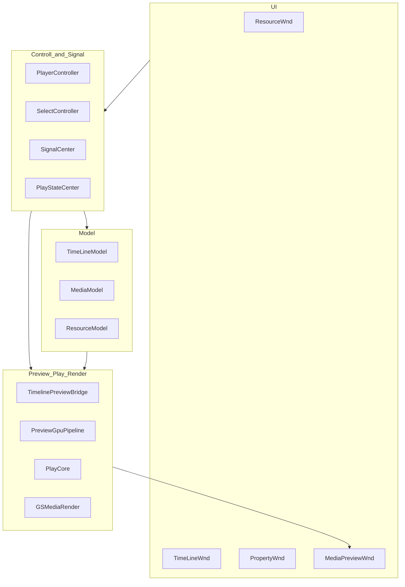
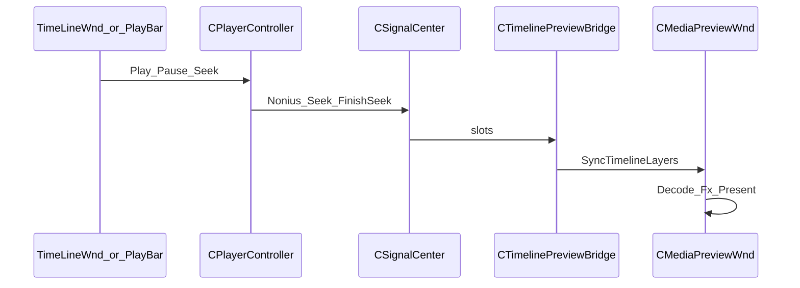

# 01 系统总览

## 目录

- [1. 产品定位与范围](#1-产品定位与范围)
- [2. 逻辑分层](#2-逻辑分层)
- [3. 物理形态：单体可执行文件](#3-物理形态单体可执行文件)
- [4. 仓库结构](#4-仓库结构)
- [5. 模块编入状态](#5-模块编入状态)
- [6. 主数据流](#6-主数据流)
- [7. 启动与单例顺序](#7-启动与单例顺序)
- [8. 相关分册](#8-相关分册)

## 1. 产品定位与范围

Timeline 是基于 **Qt5 + C++17** 的时间线编辑器，面向本地一体预览：

- 四窗格：素材库 | 预览 | 属性 | 时间线
- FFmpeg 解码 + 预览区 D3D11 Present + SDL3 音频
- ClipFx / TransFx 属性与预览联动

**当前不做（或未编入主路径）：**

- 拖素材入轨、工程完整存盘
- 多屏拼接 / 3D 映射 / Spout
- 控制端与播放端分离、网络播控
- 完整 TimeLinePlayer / AudioRender 产品栈

## 2. 逻辑分层



| 层 | 职责 |
|----|------|
| UI | 交互与展示 |
| Controll + SignalCenter | 播控、选中、跨窗总线 |
| Model | 时间线 / 媒体属性 / 素材树 |
| Preview + PlayCore + GSMedia | 解码、同步、渲染特效 |

## 3. 物理形态：单体可执行文件

| 事实 | 路径 |
|------|------|
| 根工程 | [CMakeLists.txt](../CMakeLists.txt) → `ADD_SUBDIRECTORY(Src)` |
| Src 仅建 App | [Src/CMakeLists.txt](../Src/CMakeLists.txt)：`ADD_SUBDIRECTORY(Libs)` 已注释 |
| 唯一 exe | [Src/App/Timeline/CMakeLists.txt](../Src/App/Timeline/CMakeLists.txt) |
| Libs 源码 | 由 App CMake `FILE(GLOB…)` / 显式列出，编入同一目标 |
| 宏 | 大量 `*_STATIC_LIB`，保留多 DLL 产品形态的头文件/导出习惯 |

结论：**逻辑上分模块，物理上一个 Timeline.exe。**

## 4. 仓库结构

```text
Timeline/
├── CMakeLists.txt
├── Debug.bat / Release.bat / Pack.bat / MoveFilesToInstaller.bat
├── Timeline.bld
├── README.md
├── doc/                    # 本设计文档目录
├── cmake/                  # wis* 与 Find* 模块
├── 3rdparty/               # FFmpeg / SDL3 / OpenCV / Boost / Rapidjson / DirectXTex …
├── Installer/              # NSIS 脚本与部署 staging
└── Src/
    ├── App/Timeline/       # 主程序与预览桥接
    └── Libs/
        ├── Common/         # Common、SignalCenter、UICommon、CltLog …
        ├── Controll/       # Player / Select / PlayState / PlayCommand …
        ├── GSMedia/        # Demuxer、Render*、TimeServer …
        ├── GSResource/     # QRC 皮肤与图片
        ├── Model/          # TimeLine / Media / Resource / Global …
        ├── Play/           # PlayCore（及磁盘上未编入的 Player 等）
        ├── Stubs/          # 本地播控与单例桩
        ├── UI/             # TimeLineWnd / ResourceWnd / PropertyWnd
        └── Net/            # 网络相关（当前未链入 exe）
```

构建产物目录（生成物，默认 gitignore）：`build/`、`bin/`、`lib/`、`Pack/` 等。详见 [02-build-and-packaging.md](02-build-and-packaging.md)。

## 5. 模块编入状态

| 区域 | 状态 | 说明 |
|------|------|------|
| App/Timeline | 已编入 | 主窗、Bridge、GPU/软解、FxPass |
| UI/*Wnd | 已编入 | 时间线 / 素材 / 属性 |
| Model TimeLine/Media/Resource | 已编入 | 核心数据 |
| Common + SignalCenter + UICommon | 已编入 | |
| Stubs | 已编入 | `LocalPlayTransport` 等 |
| Play/PlayCore | 已编入 | `CMMDecoder` 等 |
| GSMedia Demuxer + 选定 Render* | 已编入 | 设备、Present、特效 |
| Controll 头 + PlayState 辅助 cpp | 部分 | 实现多在 Stubs；关键帧/滤镜辅助有真实 cpp |
| Net、完整 Player/AudioRender | 仅存盘 | 未进 App CMake |
| ModelModel / ScreenModel | 基本仅头/导出 | 非当前主路径 |

## 6. 主数据流



更细的时钟侧见 [05-play-control.md](05-play-control.md)，出帧与解码见 [06-preview-pipeline.md](06-preview-pipeline.md)，着色与特效见 [07-render-and-effects.md](07-render-and-effects.md)。

## 7. 启动与单例顺序

[`MainWindow.cpp`](../Src/App/Timeline/MainWindow.cpp) 构造中：

1. `InitSignalCenter`
2. `InitTimeLineModel`
3. `InitSelectController`
4. `InitPlayerController`
5. `PlayCommandCenter::InitPlayCommandController`
6. `InitHistoryStack`
7. `InitViewDataManager`
8. `PlayStateCenter::InitPlayStateCenter`
9. `InitMediaModel`
10. `InitResourceModel`
11. `TimeServer_Init`
12. `g_pConvertHelper` 设置 FPS / DropMode

随后创建四窗格：`CResourceWnd` | `CMediaPreviewWnd` + `CPreviewPlayBar` | `CTimelinePropertyHost`，下方 `CTimeLineWnd`；并挂接 `CTimelinePreviewBridge`。

`main.cpp` 中在进主窗前初始化暗色 QSS，并调用 `CPreviewGpuPipeline::InitDevice()`。

## 8. 相关分册

- 构建：[02-build-and-packaging.md](02-build-and-packaging.md)
- UI：[03-ui-and-interaction.md](03-ui-and-interaction.md)
- 类索引：[08-reference.md](08-reference.md)
