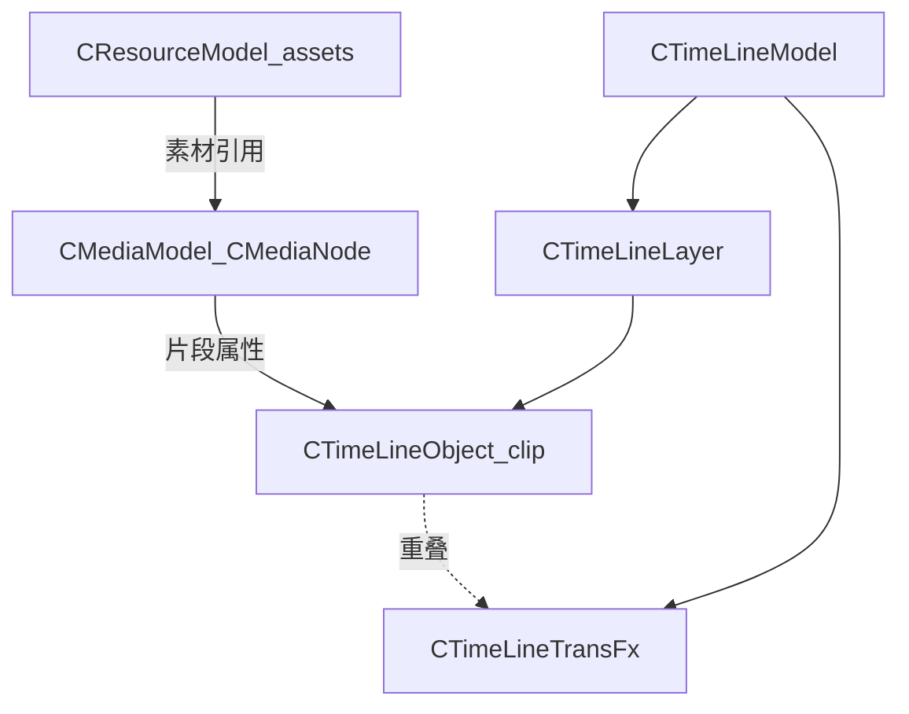

# 04 数据模型

## 目录

- [1. 模型总览](#1-模型总览)
- [2. TimeLineModel](#2-timelinemodel)
- [3. MediaModel](#3-mediamodel)
- [4. ResourceModel](#4-resourcemodel)
- [5. GlobalModel 与帧率](#5-globalmodel-与帧率)
- [6. 与播控 / 预览 / 特效的接口点](#6-与播控--预览--特效的接口点)
- [7. 相关分册](#7-相关分册)

## 1. 模型总览

路径根：[`Src/Libs/Model/`](../Src/Libs/Model/)

## 2. TimeLineModel

路径：[`Src/Libs/Model/TimeLineModel/`](../Src/Libs/Model/TimeLineModel/)

| 类型 | 职责 |
|------|------|
| `CTimeLineModel` | 时间线根：时长、区段播放模式、图层集合 |
| `CTimeLineLayer` | 图层：可见性、顺序、片段列表 |
| `CTimeLineObject` | 轨上片段：起止、绑定资源/媒体、ClipFx 关键帧等 |
| `CTimeLineSection` / Tag / Note | 区段、标记、便签 |
| `CTimeLineTransFx` | 转场：类型、时长、关联片段 |
| `CConvertHelper` (`g_pConvertHelper`) | 时间 ↔ 帧；FPS 24/25/30/60（无 29.97） |

播控读取：`GetDuration`、`GetSection`、区段循环/到头暂停模式等（见 [05](05-play-control.md)）。

预览读取：在给定 `timelineMs` 上解析可见层与活动片段（Bridge，见 [06](06-preview-pipeline.md)）。

## 3. MediaModel

路径：[`Src/Libs/Model/MediaModel/`](../Src/Libs/Model/MediaModel/)

| 类型 | 职责 |
|------|------|
| `CMediaModel` | 媒体节点管理 |
| `CMediaNode` | 单媒体实例属性：音量、颜色、变换、特效因子等 |
| Effect / Transform / Keyframe 相关 | 与属性面板、ClipFx 写回对应 |

`CPreviewFxPass::BindClip` 从 MediaNode 绑定 `SMediaPty`（含 Fx / Base / Effect），供渲染采样。属性关键帧 ID 定义见 Common 中 `MediaPropertyKeyframeIds`。

## 4. ResourceModel

路径：[`Src/Libs/Model/ResourceModel/`](../Src/Libs/Model/ResourceModel/)

| 类型 | 职责 |
|------|------|
| `CResourceModel` | 素材树 Qt Model |
| `C*Resource` / `CResourceNodeInfo` | 各类资源节点与元数据 |

导入时 Demuxer（`GSMedia/Demuxer`）填充时长、分辨率、音视频轨信息。Resource 与轨上 Object通过 UUID / 路径关联。

## 5. GlobalModel 与帧率

路径：[`Src/Libs/Model/GlobalModel/`](../Src/Libs/Model/GlobalModel/)

| 类型 | 职责 |
|------|------|
| `PrjSettingData` / `g_pProjectSetting` | 工程设置（含时间线 FPS 加载） |
| `SoftwareSettingData` / `AppPath` 等 | 软件名、路径、缓存目录等 |

主窗启动：`g_pConvertHelper->setFPS(g_pProjectSetting->LoadTimeLineFps())`。

工程完整存盘不在当前产品主路径（Stub / 简化）。

## 6. 与播控 / 预览 / 特效的接口点

| 消费方 | 读取 / 写入 |
|--------|-------------|
| 播控 | 时长、区段边界、区段模式；进度不写入 Model，由 PlayState 锚点持有 |
| Bridge | 可见层、clip 路径、clip 局部时间、效果采样时刻 |
| 属性 UI | 写 MediaNode / TransFx；发 `signalUpdateMediaProperty` |
| PreviewFxPass | 读 MediaNode 特效与变换；TransInfo 来自转场数据 |
| ClipFx 时间线 UI | 关键帧曲线与 MediaNode 双向同步信号 |

## 7. 相关分册

- UI 属性面板：[03-ui-and-interaction.md](03-ui-and-interaction.md)
- 播控：[05-play-control.md](05-play-control.md)
- 特效参数消费：[07-render-and-effects.md](07-render-and-effects.md)
