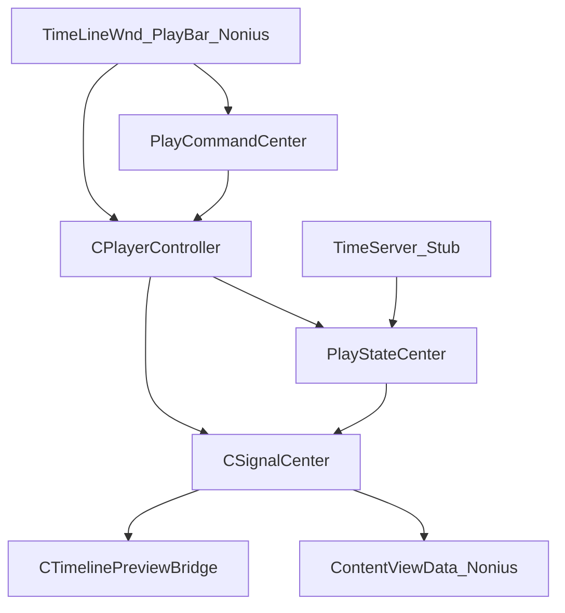
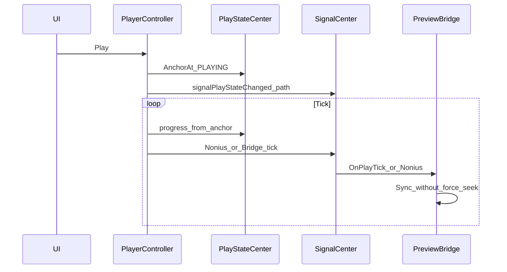
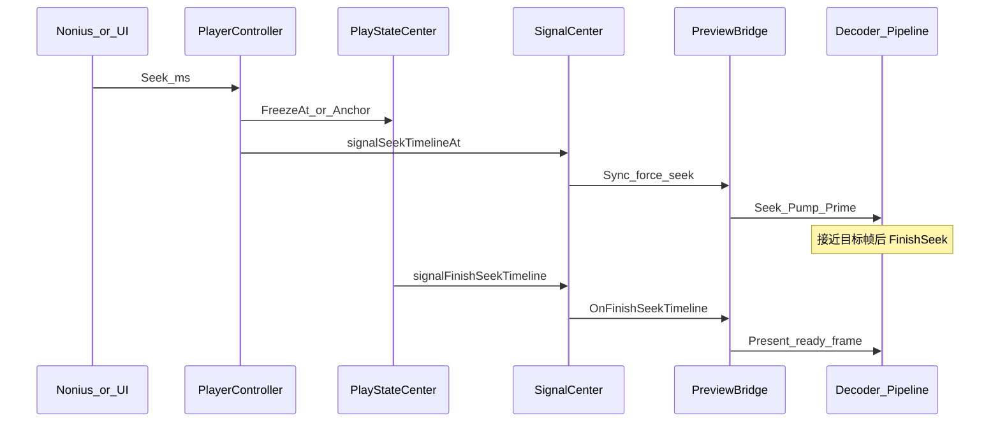

# 05 播控结构

## 目录

- [1. 播控总图](#1-播控总图)
- [2. Controll 目录职责](#2-controll-目录职责)
- [3. 本地实现主体 LocalPlayTransport](#3-本地实现主体-localplaytransport)
- [4. CPlayerController](#4-cplayercontroller)
- [5. PlayCommandCenter](#5-playcommandcenter)
- [6. PlayStateCenter](#6-playstatecenter)
- [7. TimeServer Stub](#7-timeserver-stub)
- [8. SelectController 边界](#8-selectcontroller-边界)
- [9. SignalCenter 播控相关信号](#9-signalcenter-播控相关信号)
- [10. 时序：播放](#10-时序播放)
- [11. 时序：暂停 Seek](#11-时序暂停-seek)
- [12. 与预览管线分界](#12-与预览管线分界)
- [13. 相关分册](#13-相关分册)

## 1. 播控总图

本工程为**本地一体播控**：不分离控制端 / 播放端，无网络命令桥。

头文件多在 [`Src/Libs/Controll/`](../Src/Libs/Controll/)；**可运行逻辑**大量在 [`Src/Libs/Stubs/LocalPlayTransport.cpp`](../Src/Libs/Stubs/LocalPlayTransport.cpp)。

## 2. Controll 目录职责

| 子目录 | 状态 | 职责 |
|--------|------|------|
| `PlayerController/` | 头文件 + Stub 实现 | 本地时钟推进、Play/Pause/Stop/Seek |
| `PlayCommandCenter/` | 导出头 + Stub | 命令入口；本地直接落到 Player |
| `PlayStateCenter/` | 导出 + Stub 状态机；另有关键帧/滤镜 Helper 真实 cpp | 锚点进度、FinishSeek 通知 |
| `SelectController/` | 头 + Stub/实现 | 选中集（非时钟） |
| `ViewDataManager/` | 导出 + Stub | 视图数据占位 |
| `GlobalHistoryStack/` | 导出 + Stub | 撤销栈占位 |
| `RenderController/` | 导出头为主 | 完整渲染控制未接入主路径 |

## 3. 本地实现主体 LocalPlayTransport

[`LocalPlayTransport.cpp`](../Src/Libs/Stubs/LocalPlayTransport.cpp) 集中实现：

- `TimeServer_*`：本地单调时钟
- `PlayStateCenter`：`SLocalPlayState`、`AnchorAt` / `FreezeAt`、`CLocalStateManager`
- `CPlayerController` 成员函数与 `QTimer` tick
- `PlayCommandCenter::OnController*` 本地分发
- 区段边界：到头暂停 / 区段循环

设计意图：保留 Controll 接口外形，运行时全部本进程完成。

## 4. CPlayerController

头文件：[`PlayerController.h`](../Src/Libs/Controll/PlayerController/PlayerController.h)

| API | 行为（本地） |
|-----|----------------|
| `Play` / `Pause` / `Stop` | 改 PlayState 锚点，发 `signalPlayStateChanged` |
| `Seek(ms)` | 冻结/锚定进度，驱动 Seek 相关信号链 |
| `GetCurTime` | 由锚点 + TimeServer 推算 |
| `OnPlayTick` | 定时推进；处理区段边界；通知 UI/Bridge |
| `ETimelinePlayRangeMode` | 普通 / 区段末暂停 / 区段循环（与 Model 区段模式配合） |

接口中仍保留 `CreatePlayer` / `NotifyAddMediaRender` 等产品形态 API，本地多为空实现。

全局：`g_pPlayerController` / `InitPlayerController`。

## 5. PlayCommandCenter

本地无 `CPlayCommandCenter` 实例网络桥：`GetInstance()` 可返回空；`OnControllerPlay/Pause/Seek/SeekToPause/...` 直接调用 `CPlayerController`。

UI 既可直接调 Player，也可走 Command 入口（兼容原命令表 [`PlayCommand.h`](../Src/Libs/Common/Common/PlayCommand.h)）。

## 6. PlayStateCenter

核心状态：

- `EnPlayState`：播放 / 暂停 / 区段末暂停等
- `progressAtChange` + `timeStampAtChange`：锚点，用于推算当前进度

`CLocalStateManager::FinishSeekTimeline`：

1. 按 seek 目标更新锚点
2. `emit signalFinishSeekTimeline(timelineMs)` → 预览出帧收尾（见 06）

真实编译进 exe 的辅助：

- `TimelinePropertyKeyframeHelper`
- `TimelineFilterHelper`

用于属性采样 / 滤镜阶段计算，供 Bridge 或属性路径使用。

## 7. TimeServer Stub

- `TimeServer_Init` / `GetCurTime`：`steady_clock` 相对原点
- 多机 Present 偏移、Ctrl/Server 偏移接口为空操作

保证本地播控有统一「现在」时间戳，无需外部时间服务器。

## 8. SelectController 边界

`CSelectController` 管理图层 / 对象 / Tag / TransFx 等选中集，驱动属性面板切换。

**不负责**推进播放时钟。选中变化可通过 SignalCenter 通知 UI，但与 Play/Seek 状态机分离。

## 9. SignalCenter 播控相关信号

定义见 [`SignalCenter.h`](../Src/Libs/Common/SignalCenter/SignalCenter.h)：

| 信号 | 用途 |
|------|------|
| `signalPlayPause` | 播放/暂停快捷 |
| `signalNoniusTimeChanged(qint64)` | 游标视觉/逻辑时间变更 |
| `signalSeekTimelineAt(qint64)` | 请求 Seek，同步游标与播放器 |
| `signalFinishSeekTimeline(qint64)` | Seek 出帧收尾 |
| `signalLocateNonius` | 定位游标 |
| `signalTimeLineFpsChange` | FPS 变更 |
| `signalUpdateMediaProperty` | 属性变更（驱动预览刷新，非时钟） |
| `signalStopTimeLindPause` | 停止相关暂停 |

游标数据：[`ContentViewData`](../Src/Libs/UI/TimeLineWnd/ContentViewData.h) — 播放中可仅写视觉游标，避免每帧信号扇出。

## 10. 时序：播放

## 11. 时序：暂停 Seek

时钟与状态在本册；Decoder `FinishSeek` / Present 细节在 [06](06-preview-pipeline.md)。

## 12. 与预览管线分界

| 本册（05） | 预览册（06） |
|------------|--------------|
| Play/Pause/Stop/Seek API | Bridge 解析可见层 |
| 锚点进度、区段边界 | `SyncLayers` / `PumpLayer` |
| `signalFinishSeekTimeline` 发出 | 收信号并完成出帧 Present |
| 不碰 D3D 纹理 | 管理解码槽与软解回落 |

## 13. 相关分册

- UI 入口：[03-ui-and-interaction.md](03-ui-and-interaction.md)
- 预览出帧：[06-preview-pipeline.md](06-preview-pipeline.md)
- 信号全表摘要：[08-reference.md](08-reference.md)
