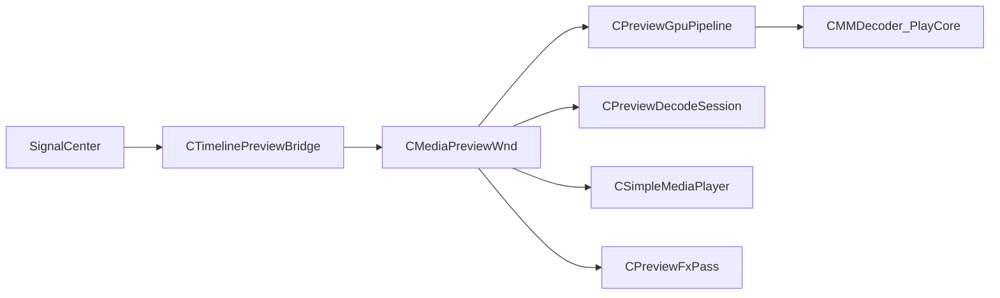

# 06 预览管线

## 目录

- [1. 职责与分界](#1-职责与分界)
- [2. 组件总览](#2-组件总览)
- [3. CTimelinePreviewBridge](#3-ctimelinepreviewbridge)
- [4. CPreviewGpuPipeline](#4-cpreviewgpupipeline)
- [5. 软解回落](#5-软解回落)
- [6. Seek 出帧](#6-seek-出帧)
- [7. 音频旁路](#7-音频旁路)
- [8. 与渲染特效的衔接](#8-与渲染特效的衔接)
- [9. 能力边界](#9-能力边界)
- [10. 相关分册](#10-相关分册)

## 1. 职责与分界

本册描述：**哪路媒体、如何同步到预览窗**。

| 侧 | 文档 |
|----|------|
| 时钟与 Play/Seek 状态 | [05-play-control.md](05-play-control.md) |
| 同步、解码槽、软硬切换 | 本册 |
| Present 着色、ClipFx、TransFx | [07-render-and-effects.md](07-render-and-effects.md) |

## 2. 组件总览

路径：[`Src/App/Timeline/`](../Src/App/Timeline/)

## 3. CTimelinePreviewBridge

头文件：[`TimelinePreviewBridge.h`](../Src/App/Timeline/TimelinePreviewBridge.h)

| 能力 | 说明 |
|------|------|
| `OnPlayStateChanged` | 跟随 Player 播放/暂停 |
| `OnNoniusTimeChanged` | 游标变化（可 debounce） |
| `OnFinishSeekTimeline` | 收 05 的 FinishSeek 信号，强制同步出帧 |
| `ResolveVisibleLayers` | 自 TimeLineModel 取可见层列表 |
| `ResolveActiveClip` | 单路兼容路径解析 |
| `FillLayerEffects` | 采样关键帧 / ClipFx / TransFx 填入 `SPreviewLayerInfo` |
| `SyncTimelineAt` | `bForceSeek` 区分播放跟钟与 Seek 全量 |

输出到 `CMediaPreviewWnd::SyncTimelineLayers` / 相关 Sync API。

## 4. CPreviewGpuPipeline

头文件：[`PreviewGpuPipeline.h`](../Src/App/Timeline/PreviewGpuPipeline.h)

| 要点 | 说明 |
|------|------|
| 单例 | `Instance()`；`main` 中 `InitDevice` |
| 同设备 | 预览 Present 与硬解共享 D3D11 设备，避免跨设备 SRV |
| `kMaxSlots = 4` | 最多 4 路硬解并行，底→顶合成 |
| `SyncLayers` | 按 path+clipId 复用槽；多余关闭 |
| `SeekLayer` / `PumpLayer` | 每层独立 Seek 与取帧 |
| `FinishSeekLayer` / `PrimeSeekFrames` | Seek 后有限次阻塞 Pump 直至就绪 |

底层解码：[`Play/PlayCore`](../Src/Libs/Play/PlayCore/) 的 `CMMDecoder`（D3D11VA → RGBA）等。

## 5. 软解回落

| 组件 | 职责 |
|------|------|
| `CPreviewDecodeSession` | 软解帧环、Seek 后 prime、seeking 标志 |
| `CSimpleMediaPlayer` | 精简 FFmpeg + SDL3，单文件浏览场景 |

硬解失败或未就绪时，预览窗回落到软解路径；软解为回落而非主推多层路径。

## 6. Seek 出帧

与 05 配合的完整链路：

1. UI / Player → `signalSeekTimelineAt`
2. Bridge `SyncTimelineAt(..., forceSeek=true)`
3. GPU：`SeekLayer` → 保持 seeking → `Pump` 接近目标 → `FinishSeek`
4. 或 `PrimeSeekFrames` 阻塞有限次
5. PlayState `FinishSeekTimeline` → `signalFinishSeekTimeline`
6. Bridge `OnFinishSeekTimeline` → 再 Present，避免「慢一拍」旧帧

实现细节还涉及：丢弃过早 GOP 帧、abort 过期 prime、`seekEpoch` 防止过期 Present（见 `MMDecoder` / Preview 相关源）。

## 7. 音频旁路

多层硬解预览下，音频常走旁路：打开音频轨 + SDL 播放，音量可跟关键帧。完整 AudioRender / 多机音频矩阵未编入。

## 8. 与渲染特效的衔接

`CMediaPreviewWnd` 在拿到层纹理后：

1. 可选 `CPreviewFxPass::Apply`（ClipFx）
2. 取裁剪 UV / 变换 / 转场顶点
3. 调用 Present（色调、alpha 合成）

算法与 HLSL 见 [07-render-and-effects.md](07-render-and-effects.md)。本册只保证「正确的纹理在正确的时钟到达预览窗」。

## 9. 能力边界

- 预览最多约 4 路硬解合成
- 未编入完整 TimeLinePlayer 双片纹理转场栈（顶点/Fade 路径见 07）
- 工程级多屏输出不在范围

## 10. 相关分册

- 播控时钟：[05-play-control.md](05-play-control.md)
- 渲染特效：[07-render-and-effects.md](07-render-and-effects.md)
- 模型解析输入：[04-data-model.md](04-data-model.md)
