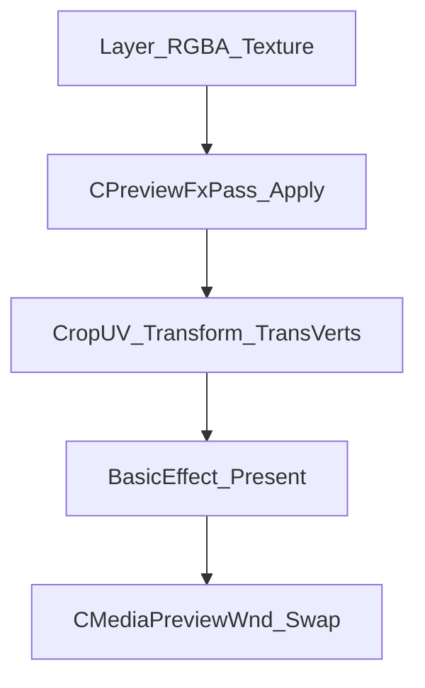
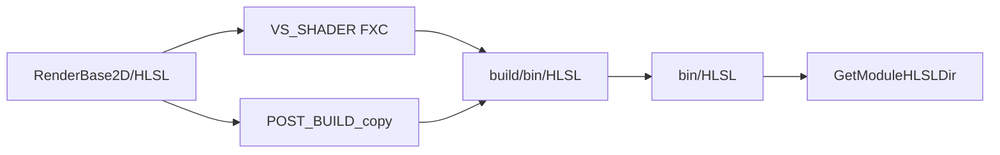

# 07 渲染与特效

## 目录

- [1. 职责与分界](#1-职责与分界)
- [2. 渲染栈总图](#2-渲染栈总图)
- [3. GSMedia 渲染模块](#3-gsmedia-渲染模块)
- [4. 设备与同设备约定](#4-设备与同设备约定)
- [5. Present 与色调](#5-present-与色调)
- [6. ClipFx 离屏特效](#6-clipfx-离屏特效)
- [7. TransFx 转场](#7-transfx-转场)
- [8. 几何：裁剪与变换](#8-几何裁剪与变换)
- [9. 属性刷新路径](#9-属性刷新路径)
- [10. HLSL 部署与加载](#10-hlsl-部署与加载)
- [11. 能力边界](#11-能力边界)
- [12. 相关分册](#12-相关分册)

## 1. 职责与分界

本册描述：**画面如何计算**（着色、特效、转场、几何）。

解码槽与层同步见 [06-preview-pipeline.md](06-preview-pipeline.md)；特效参数来源见 [04-data-model.md](04-data-model.md)。

## 2. 渲染栈总图



多层时：自底向顶对每层执行（可选 Fx）→ 按 alpha / 混合 Present。

## 3. GSMedia 渲染模块

| 目录 | 关键类型 | 职责 |
|------|----------|------|
| [`RenderDevice/`](../Src/Libs/GSMedia/RenderDevice/) | `DeviceResource`、`D3DWrapper` | D3D11 设备封装 |
| [`RenderCommon/`](../Src/Libs/GSMedia/RenderCommon/) | Vertex、RenderStates、TextureRender、EffectHelper、SimpleMath | 公共 DX 工具 |
| [`RenderBase2D/`](../Src/Libs/GSMedia/RenderBase2D/) | `BasicEffect`、`HLSL/` | 2D Present 着色器 |
| [`RenderItem/`](../Src/Libs/GSMedia/RenderItem/) | `CD3DEffectRender`、`VertexCalculator` | ClipFx 离屏、转场顶点 |

公共数据结构：[`XEffectCommon.h`](../Src/Libs/Common/Common/XEffectCommon.h)、[`IRenderParamDefine.h`](../Src/Libs/Common/Common/IRenderParamDefine.h)（颜色、填充、翻转等）。

App 侧胶水：[`PreviewFxPass`](../Src/App/Timeline/PreviewFxPass.h)、[`MediaPreviewWnd`](../Src/App/Timeline/MediaPreviewWnd.cpp)。

## 4. 设备与同设备约定

- `CPreviewGpuPipeline::InitDevice` 创建/持有解码与 Present 共用的 D3D11 设备
- `CPreviewFxPass` 与 Pipeline **共用 Device_Decode**，避免跨设备 ShaderResourceView
- 软解路径可将 CPU 帧上传到同设备纹理再走 Present

## 5. Present 与色调

预览 Present 使用 `BasicEffect` + HLSL，对画面做颜色调整，典型包括：

- 亮度 / 对比度 / 色相 / 饱和度
- RGBA 乘性 / 偏置类调整（与媒体颜色属性结构对应）

暂停拖属性时，经 `signalUpdateMediaProperty` 即时刷新 Present，无需重新 Play。

## 6. ClipFx 离屏特效

[`CPreviewFxPass`](../Src/App/Timeline/PreviewFxPass.h)：

| API | 说明 |
|-----|------|
| `BindClip` | 从 MediaNode 绑定 `SMediaPty` |
| `Apply(inSrv, inTex, w,h, ptsUs)` | 对输入纹理做可见 ClipFx；无特效则原样返回 |
| `GetCropUv` | 裁剪后的 UV |
| `GetPreviewTransform` | NDC 偏移 / 缩放 / 旋转 |

内部调用 `CD3DEffectRender::MediaFxRender`。常见效果类型（以 `EEffectType` / 因子为准）：Keying、Feather、Blur、Cut、Scroll、Shake 等；具体启用取决于 MediaNode 中因子是否存在。

抠像等路径可使用点采样（PointClamp）以保证边缘正确。

## 7. TransFx 转场

| 路径 | 说明 |
|------|------|
| Fade | 多由 alpha 合成处理；`BuildTransVertices` 返回 false |
| 顶点类转场 | `CPreviewFxPass::BuildTransVertices` → `VertexCalculator` 生成 NDC 顶点/索引 |
| 数据 | `STransInfo` / `CTimeLineTransFx`；属性面板开放 `ETFT_*` 类型 |

时间线 UI：`CClipTransFxWidget` 半段编辑 / 拉伸；重叠自动创建见 TimeLine OverlapHelper。

完整「双片纹理产品级转场机」未作为独立播放器栈编入；当前以预览 Present 路径为主。

## 8. 几何：裁剪与变换

预览 letterbox 四边形由以下组合：

1. 裁剪 UV（Cut / Crop 类 Fx 更新后）
2. 位置 / 缩放 / 旋转（相对画布中心的 NDC）
3. 填充模式（如 KeepRatio，见 `EMediaFillType`）
4. 可选转场变形顶点替代简单四边形

## 9. 属性刷新路径

```text
属性滑条 / ClipFx Plot
  → 写 MediaNode / 关键帧
  → signalUpdateMediaProperty / signalClipFxPropertyKeyframeChanged / signalRefreshWindow
  → Bridge::OnMediaPropertyChanged 或预览直接 Refresh
  → 重新 BindClip / Apply / Present
```

关键帧采样时刻：播放头 clip 局部时间或 Plot 指定 `clipLocalMs`。

## 10. HLSL 部署与加载

### 放哪里

| 层级 | 路径 | 内容 |
|------|------|------|
| 源码树 | [`Src/Libs/GSMedia/RenderBase2D/HLSL/`](../Src/Libs/GSMedia/RenderBase2D/HLSL/) | `.hlsl` / `.hlsli`（唯一源） |
| 编译输出 | `build/bin/HLSL/`（CMake `BIN_DIR`） | FXC 产出 **`.cso`**；POST_BUILD 再拷源码（`.hlsli` / `.hlsl` 回退） |
| 运行入口 | 根 `bin/HLSL/`（`Debug.bat` / `Release.bat` 从 `build/bin/HLSL` 同步） | 与 `Timeline.exe` 同级 |
| 安装包 | `Installer/Timeline/HLSL/`（PrepareDeploy） | 随安装包 |



### 怎么加载

[`BasicEffect::InitAll`](../Src/Libs/GSMedia/RenderBase2D/BasicEffect.cpp) / [`GetModuleHLSLDir`](../Src/Libs/GSMedia/RenderCommon/d3dHelper.h)：

1. `GetModuleFileName(NULL)` → exe 目录（**不依赖 CWD / AppPath**）
2. 目录固定 `{exeDir}\HLSL\`
3. `CreateShaderFromFile`：**先读 `.cso`，失败再绝对路径编译 `.hlsl`**
4. 失败返回 `false`（预览可回落），不弹 DXTrace 进调试器

构建侧：[`Src/App/Timeline/CMakeLists.txt`](../Src/App/Timeline/CMakeLists.txt) 将 HLSL 编入目标并设置 `VS_SHADER_OBJECT_FILE_NAME` → `${BIN_DIR}/HLSL/%(Filename).cso`。

## 11. 能力边界

- 特效以预览窗为汇聚点，非独立输出卡渲染线程产品栈
- ThreadManager / 完整 TimeServer 多机同步未接入
- 部分 GSMedia / Play 目录仅磁盘遗留，未进单体链接

## 12. 相关分册

- 预览同步：[06-preview-pipeline.md](06-preview-pipeline.md)
- 数据参数：[04-data-model.md](04-data-model.md)
- UI 属性 / ClipFx：[03-ui-and-interaction.md](03-ui-and-interaction.md)
- 类索引：[08-reference.md](08-reference.md)
