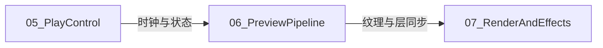

# Timeline 设计文档

Qt5 / C++17 时间线编辑软件。物理形态为单体可执行文件 `Timeline.exe`（Libs 源码 GLOB 编入同一目标）。

本目录为项目**全部设计文档**入口；下文为总分结构中的「总」。

## 总目录

| 分册 | 说明 |
|------|------|
| [01-system-overview.md](01-system-overview.md) | 系统总览：分层、仓库树、主链路、启动顺序 |
| [02-build-and-packaging.md](02-build-and-packaging.md) | 构建、输出布局、打包 |
| [03-ui-and-interaction.md](03-ui-and-interaction.md) | App 壳、四窗格 UI、交互入口 |
| [04-data-model.md](04-data-model.md) | TimeLine / Media / Resource 数据模型 |
| [05-play-control.md](05-play-control.md) | 播控结构（时钟、命令、状态、信号） |
| [06-preview-pipeline.md](06-preview-pipeline.md) | 预览同步与解码管线 |
| [07-render-and-effects.md](07-render-and-effects.md) | 渲染与特效（Present、ClipFx、TransFx） |
| [08-reference.md](08-reference.md) | 附录：命名约定、类/信号索引、能力边界 |

## 阅读地图

```text
新人上手：本页 → 01 → 02 → 03
改播控 / Seek：05 → 06（时钟侧 → 出帧侧）
改画面 / 特效 / 转场：07（属性数据见 04，刷新入口见 03 / 06）
改属性关键帧：04 → 03 → 07
查类名 / 信号：08
```

## 运行时三层分界（必读）



- **05 播控**：何时播、播到哪。
- **06 预览管线**：哪路媒体、如何同步到预览窗。
- **07 渲染与特效**：画面如何计算（着色、ClipFx、TransFx）。

## 短术语

| 术语 | 含义 |
|------|------|
| Nonius | 时间线游标（播放头） |
| Seek / FinishSeek | 定位解码目标；首帧就绪后再清除 seeking |
| ClipFx | 片段特效（抠像、羽化、模糊等） |
| TransFx | 片段间转场 |
| Stub | `Src/Libs/Stubs` 本地实现，替代完整产品栈中的网络/双端播控等 |
| 单体 GLOB | `Src/CMakeLists.txt` 不建独立 Libs 目标；由 App CMake 把源文件编进 exe |

## 相关入口

- 仓库根简要说明：[../README.md](../README.md)
- 打包说明：[../Installer/README.md](../Installer/README.md)
